# Gestion des étudiants — TP Spring Boot

API REST de gestion des étudiants avec MySQL, Spring Data JPA, validation, JUnit 5, Mockito et Swagger.

## Personnalisation

En plus du nom, du prénom et de la date de naissance, chaque étudiant possède :

| Champ | Règle |
| --- | --- |
| `matricule` | Obligatoire, unique, 30 caractères maximum |
| `email` | Obligatoire, valide, unique, 150 caractères maximum |
| `filiere` | Obligatoire, 100 caractères maximum |
| `niveau` | Obligatoire, de 1 à 5 |
| `telephone` | Facultatif, 10 à 15 chiffres avec `+` facultatif |

La date de naissance utilise `LocalDate` et doit être antérieure à aujourd’hui. Les noms et prénoms sont obligatoires et limités à 80 caractères.

## Technologies

- Java 17 ou supérieur, Maven 3.6.3 ou supérieur et MySQL 8.
- Spring Boot 4.1.2, Spring Web MVC, Data JPA, Data REST, DevTools et Validation.
- springdoc-openapi 3.2.0, JUnit 5 et Mockito.

Versions choisies selon les documentations [Spring Boot](https://docs.spring.io/spring-boot/) et [springdoc](https://springdoc.org/). Spring Boot 4 nécessite Java 17 minimum ; Java 8 ne convient pas à cette version. La dépendance Swagger 2.0.2 du sujet est remplacée par une version compatible avec Spring Boot 4.

## Organisation

```text
src/main/java/com/example/studentmanagement/
├── StudentManagementApplication.java
├── entity/Student.java
├── repository/StudentRepository.java
├── service/StudentService.java
└── controller/
    ├── StudentController.java
    └── ApiExceptionHandler.java
src/main/resources/application.properties
src/test/java/com/example/studentmanagement/
├── StudentControllerTest.java
├── StudentServiceTest.java
└── StudentValidationTest.java
```

Flux : client HTTP → contrôleur → service → repository → MySQL. L’injection se fait par constructeur. Le repository hérite du `findById(Integer)` qui renvoie un `Optional<Student>`. Data REST est présent conformément au sujet, mais l’export automatique du repository est désactivé afin que les écritures passent par le contrôleur et `@Valid`.

## API

| Méthode | Route | Résultat attendu |
| --- | --- | --- |
| POST | `/students/save` | Création sans `id` : 201 ; modification avec `id` existant : 200 |
| GET | `/students/all` | 200, liste des étudiants |
| GET | `/students/{id}` | 200 ou 404 |
| DELETE | `/students/delete/{id}` | 204 sans corps ou 404 |
| GET | `/students/count` | 200, nombre total |
| GET | `/students/byYear` | 200, tableaux `[année, nombre]`, triés par année |
| GET | `/students/byFiliere?filiere=Informatique` | 200, filtre sans distinction de casse, tri par nom |

Les données invalides produisent une réponse 400 avec les erreurs par champ. Un conflit d’unicité produit une réponse 409. Un identifiant inexistant lors d’une modification produit une réponse 404.

## Vérification avant dépôt

La commande `mvn -B clean verify` a réussi : **17 tests, aucun échec, aucune erreur**. L’application et les endpoints ont été exécutés avec MySQL 8.0.44 sur une instance locale isolée au port 3307. Les essais couvrent la création, la modification, les lectures, les statistiques, la recherche par filière, la validation, les doublons et la suppression. La conservation des données et des modifications a également été vérifiée après redémarrage de l’application.

Suivre [le guide de test](docs/TESTER.md) pour reproduire les vérifications et préparer le dépôt GitHub. Les deux premières images affichent les sorties réelles de Maven et du démarrage, mises en page dans le navigateur ; les suivantes sont des captures de requêtes exécutées dans Swagger.

## Captures d’écran

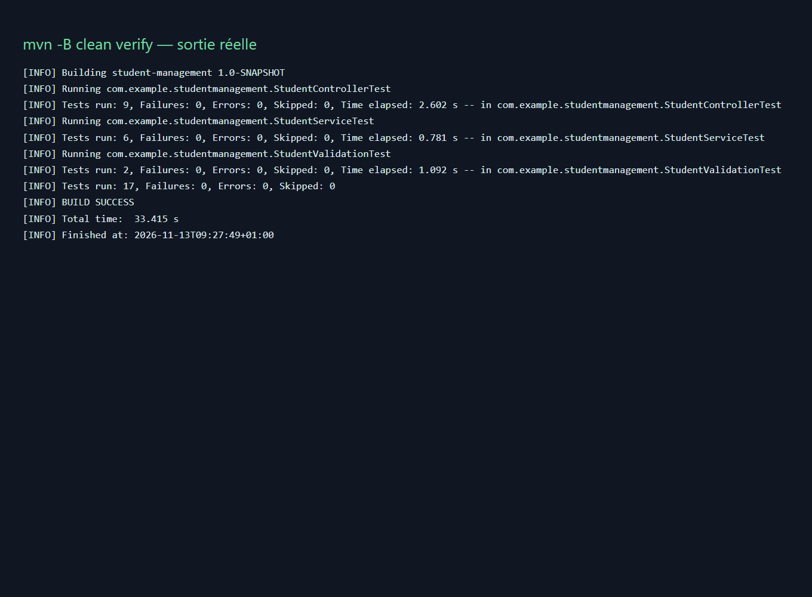

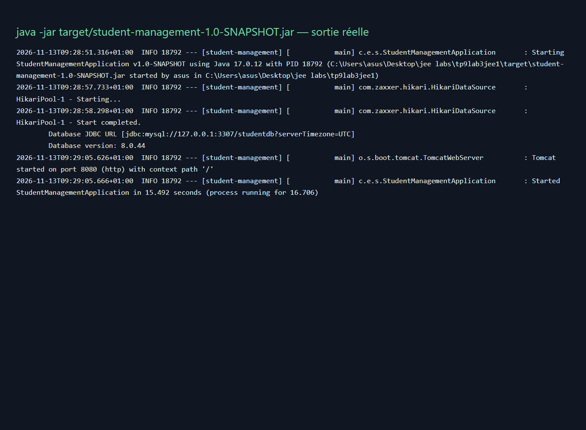

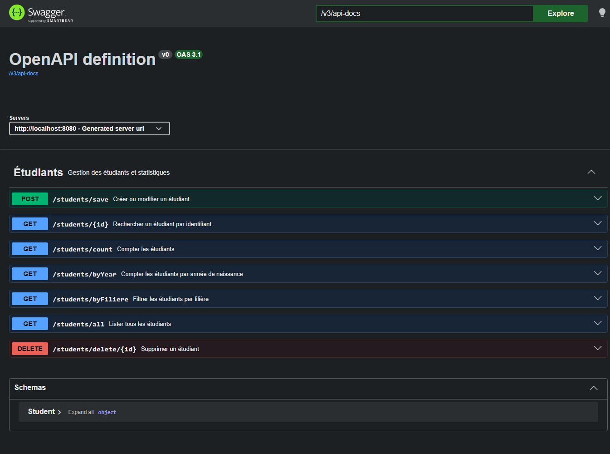

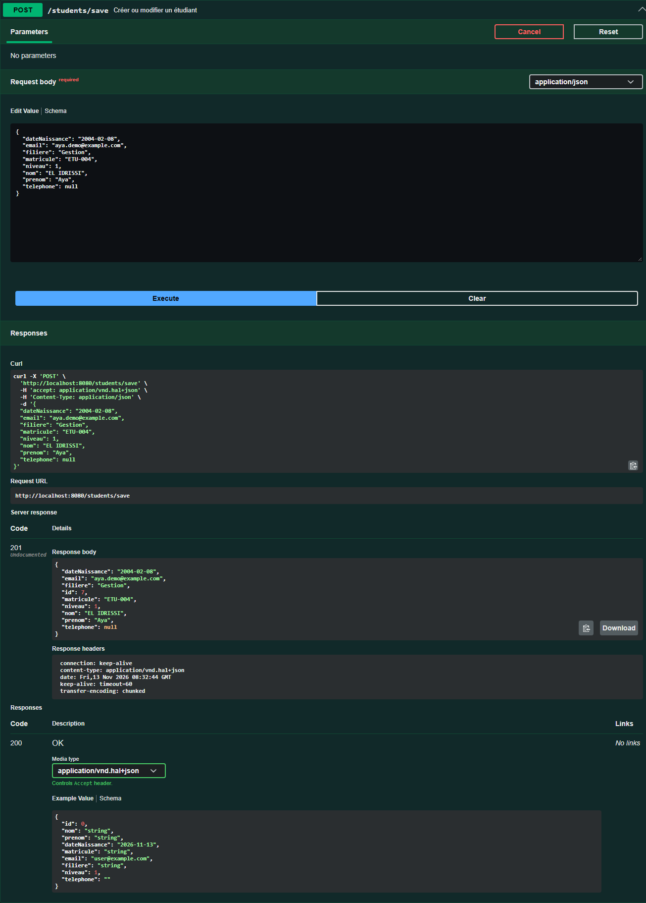

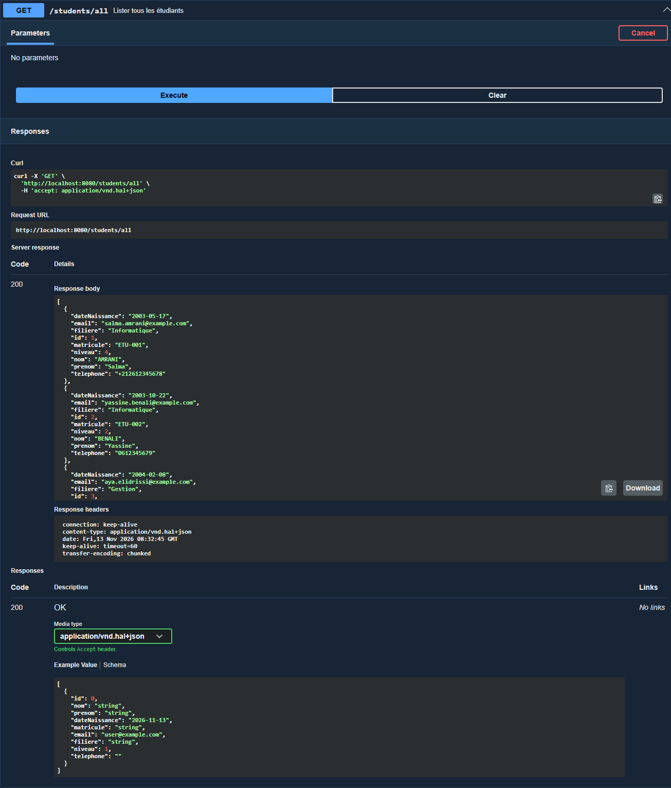

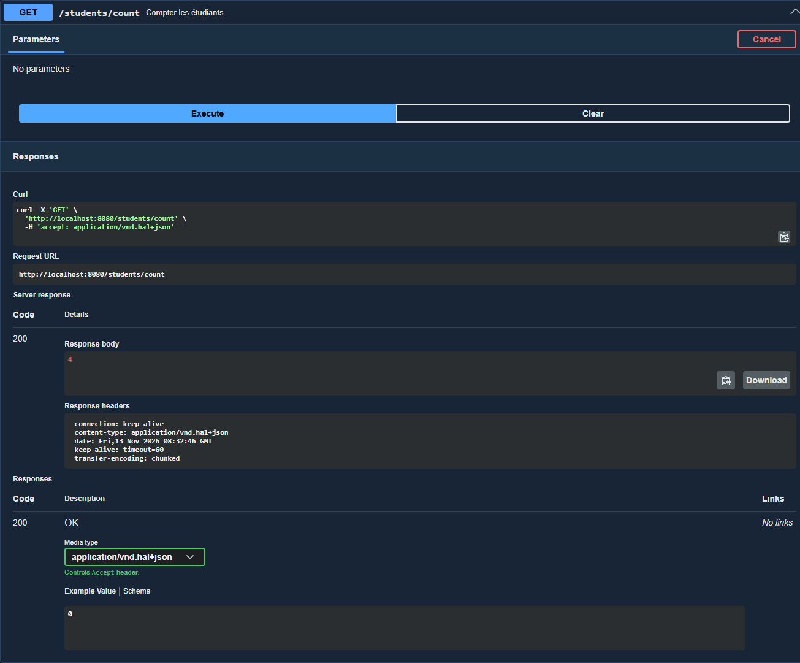

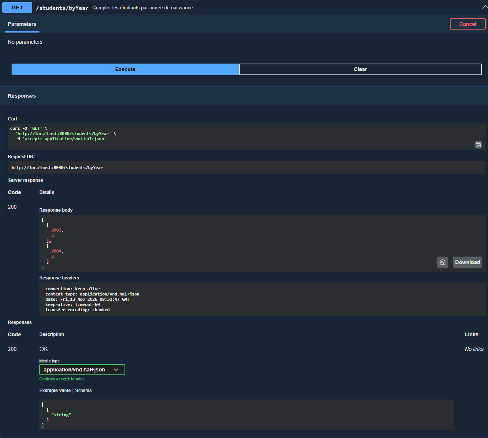

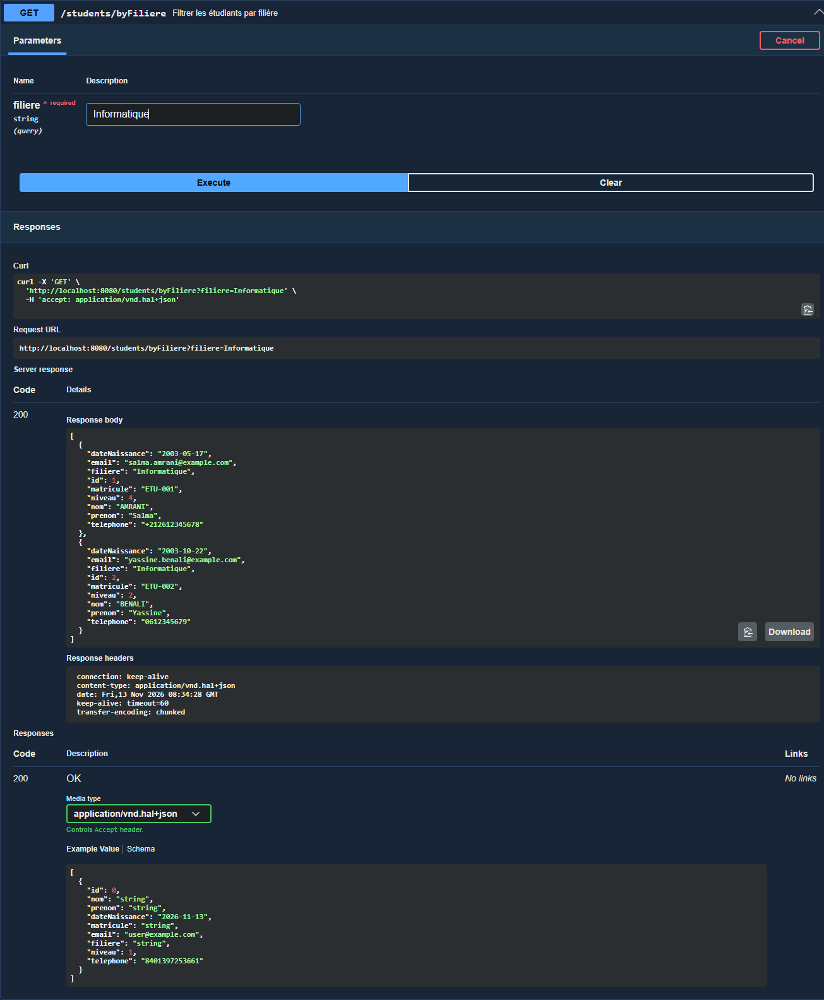

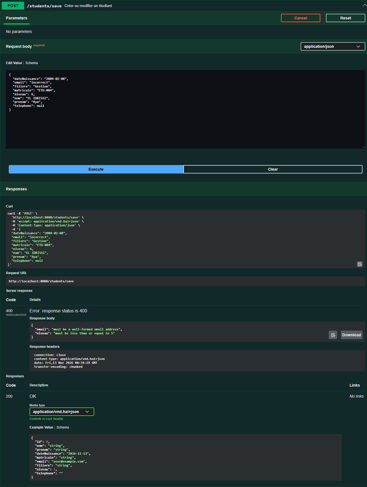

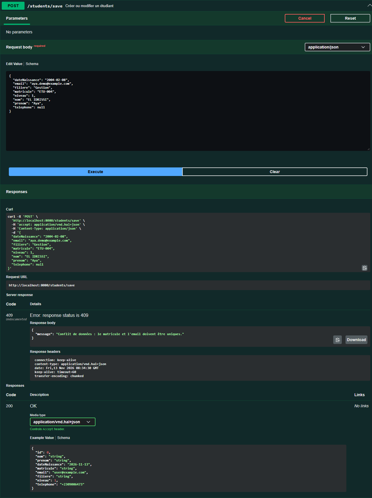

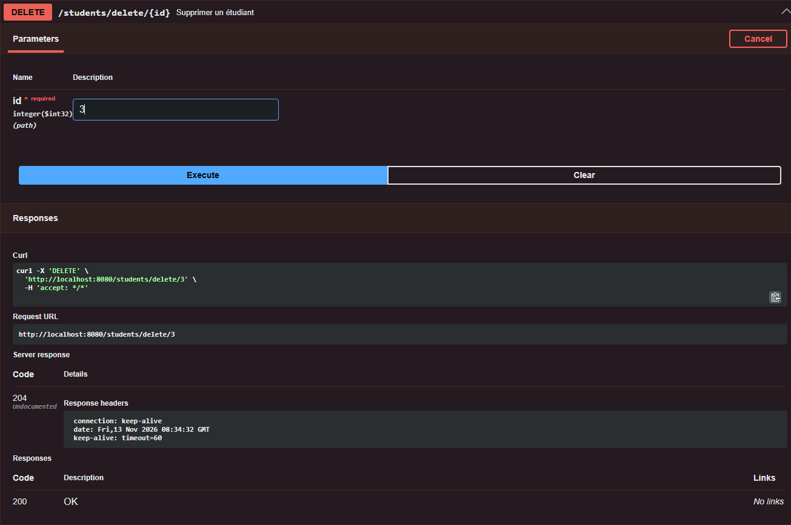

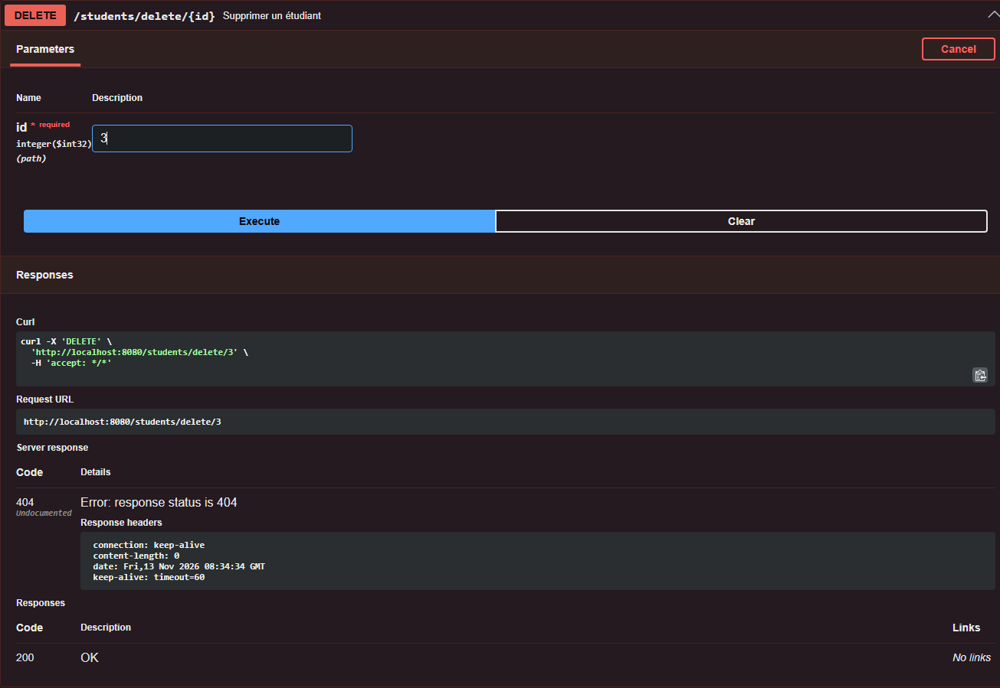
